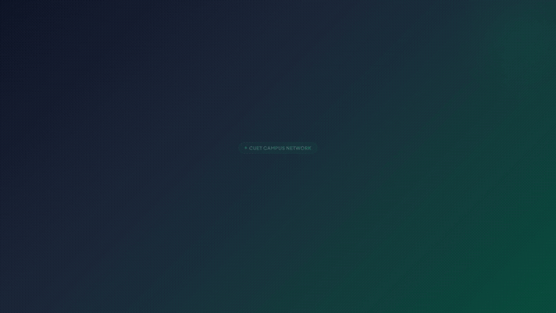
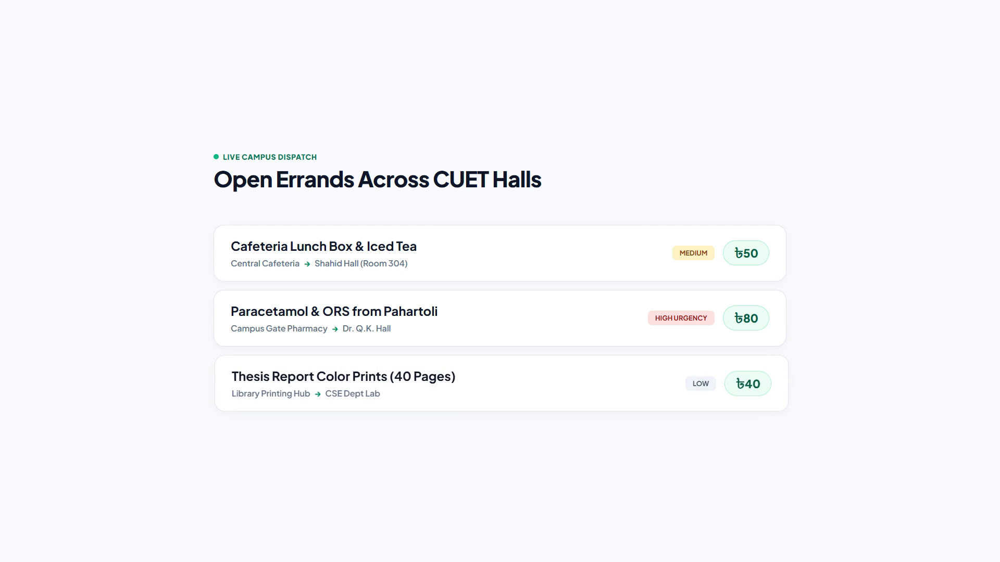
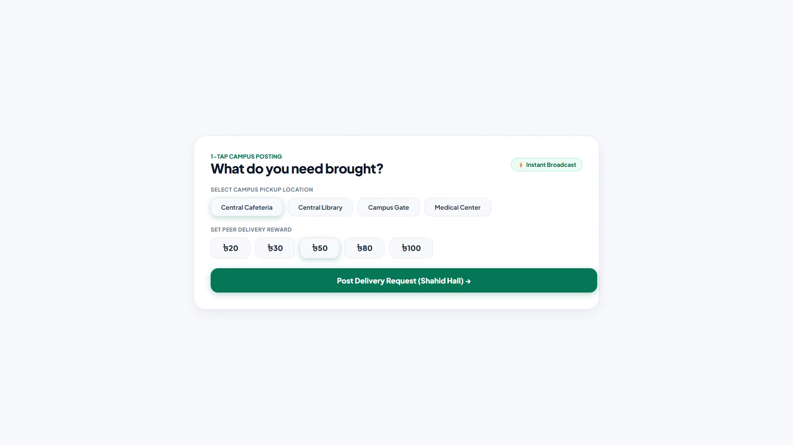
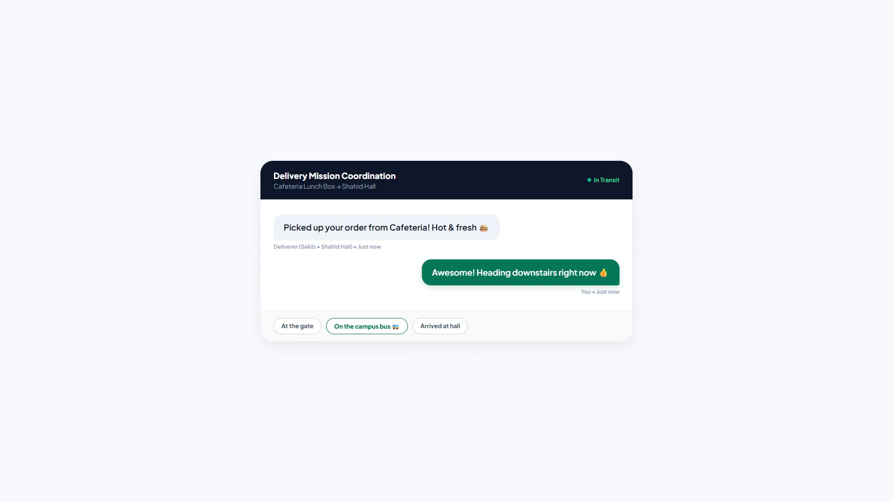
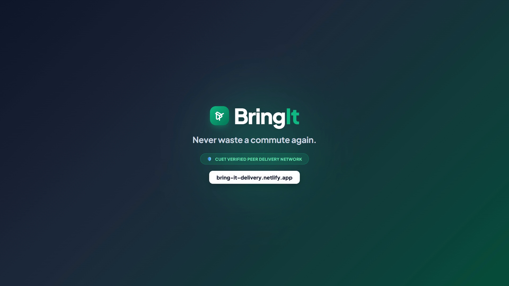
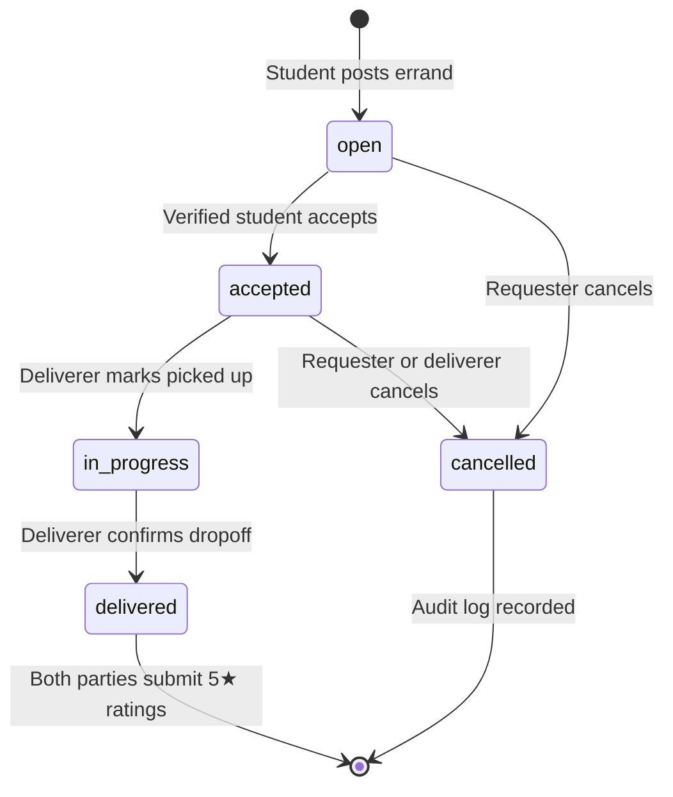

<div align="center">

# 📦 BringIt

### Fast, Trusted Peer-to-Peer Campus Delivery Network for CUET

[](https://bring-it-delivery.netlify.app)
[](https://react.dev/)
[](https://www.typescriptlang.org/)
[](https://vitejs.dev/)
[](https://tailwindcss.com/)
[](https://supabase.com/)
[](https://www.w3.org/WAI/standards-guidelines/wcag/)

<p align="center">
  <strong>Never waste a commute again.</strong> Post what you need from the city or across campus with a small peer reward, and a fellow student already walking that way brings it straight to your dormitory hall.
</p>

---

### 🎬 Product Walkthrough & Demo Video

<a href="docs/assets/bringit-demo.mp4">
  
</a>

<p align="center">
  <em>High-definition 20-second demo showcasing the complete student delivery journey.</em><br>
  👉 <strong><a href="docs/assets/bringit-demo.mp4">Download or watch high-res MP4 video (1080p · 30fps)</a></strong> · <strong><a href="brag-output/brag-plan.md">View Creative Storyboard</a></strong>
</p>

</div>

---

## 📌 Table of Contents

- [The Campus Problem & Solution](#-the-campus-problem--solution)
- [Key Features & Visual Walkthrough](#-key-features--visual-walkthrough)
  - [1. Live Campus Dispatch Radar](#1-live-campus-dispatch-radar)
  - [2. 1-Tap Errand Creation](#2-1-tap-errand-creation)
  - [3. Real-Time Mission Coordination Chat](#3-real-time-mission-coordination-chat)
  - [4. Bilateral Trust & Reputation](#4-bilateral-trust--reputation)
- [Request Lifecycle State Machine](#-request-lifecycle-state-machine)
- [System Architecture & Engineering Craft](#-system-architecture--engineering-craft)
- [Tech Stack](#-tech-stack)
- [Getting Started](#-getting-started)
- [Testing & Quality Gates](#-testing--quality-gates)
- [Project Credits](#-project-credits)

---

## 💡 The Campus Problem & Solution

CUET is located in Pahartoli, Raozan — over 25 km away from Chattogram city center. When students need urgent medication, thesis project parts, official document prints, or lunch during busy lab sessions, they face painful trade-offs:

| Existing Option | The Pain Point | How BringIt Solves It |
|---|---|---|
| **Go Yourself** | 3–4 hours lost in transit during heavy study and exam weeks. | Skip the trip entirely; a commuting peer already on that bus route brings it. |
| **WhatsApp Groups** | Urgent requests get buried under hundreds of chat messages. | Dedicated real-time dispatch radar with routes, urgency badges, and instant status. |
| **Commercial Couriers** | High delivery surcharges for a small ৳50–৳100 errand, with no hall delivery. | Fair peer micro-rewards (৳20 to ৳150) delivered right to your dorm room. |
| **Unverified Strangers** | Safety and theft risks from unvetted outsiders on campus. | Restricted strictly to verified `@cuet.ac.bd` institutional accounts with private student IDs. |

---

## 🚀 Key Features & Visual Walkthrough

### 1. Live Campus Dispatch Radar
Browse real-time open delivery requests across CUET halls and academic departments without page reloads.

<p align="center">
  
</p>

- **Instant Categorization**: Filter by Cafeteria & Snacks (`🍔`), Meds & Pharmacy (`💊`), Library & Prints (`🖨️`), or Gate Parcels (`📦`).
- **Campus Route Overview**: Clear origin-to-destination path on every card (e.g. *Central Cafeteria → Shahid Hall*).
- **Transparent Rewards**: Upfront Taka bounty badges (`৳40`, `৳50`, `৳80`) with tabular numeric layout.
- **Urgency Tags**: Color-coded urgency indicators (**Low**, **Medium**, **High**) for time-sensitive deliveries.

---

### 2. 1-Tap Errand Creation
Post a complete delivery request in under 15 seconds with zero typing friction.

<p align="center">
  
</p>

- **Campus Presets**: 1-tap buttons for prominent landmarks (*Central Cafeteria*, *Central Library*, *Campus Gate*, *Medical Center*, *Shahid Hall*, *Dr. Q.K. Hall*).
- **Suggested Reward Chips**: Quick selectable bounties (`৳20`, `৳30`, `৳50`, `৳80`, `৳100`).
- **Validation Guardrails**: Built with Zod runtime schemas ensuring non-negative rewards and validated campus destinations.

---

### 3. Real-Time Mission Coordination Chat
Private, encrypted real-time chat between the requester and deliverer for precise handoff coordination.

<p align="center">
  
</p>

- **Sub-Second Realtime**: Powered by Supabase Realtime channels with optimistic UI updates.
- **1-Tap Quick Replies**: Quick status chips for students on the move (*"On the campus bus 🚌"*, *"At the gate"*, *"Arrived at hall"*).
- **Private Communication**: Chat threads and contact details remain strictly visible to accepted participants and disappear once delivery concludes.

---

### 4. Bilateral Trust & Reputation
A safe, accountable environment built specifically for the university community.

<p align="center">
  
</p>

- **Domain-Enforced Verification**: Only students with active `@cuet.ac.bd` emails can register and accept errands.
- **Private Identity Disclosure**: Phone numbers and student IDs remain hidden until a request is accepted to prevent scraping or spam.
- **Mutual 5-Star Peer Ratings**: Both the requester and deliverer submit ratings upon delivery to foster genuine campus accountability.

---

## 🔄 Request Lifecycle State Machine

Requests strictly transition through transactional PostgreSQL RPC functions with row-level locking to guarantee atomicity and prevent race conditions:



1. **`open`**: Errand broadcasted on campus radar; visible to all verified students.
2. **`accepted`**: Deliverer commits; private chat thread opens and phone numbers are securely revealed.
3. **`in_progress`**: Item collected; transit tracker active.
4. **`delivered`**: Package safely delivered at student hall; peer reputation score awarded.

---

## 🛠️ System Architecture & Engineering Craft

BringIt is designed according to modern design-engineering and database-hardening principles:

- **Optical Micro-Typography**: Tuned tracking (`.tracking-display`, `.tracking-title`, `.tracking-body`) and font-feature settings (`"tnum"`, `"cv02"`, `"cv04"`) prevent layout shift during count-ups and numeric updates.
- **Tactile Physics**: Custom spring bezier transitions (`cubic-bezier(0.34, 1.56, 0.64, 1)`) with `.pressable` feedback provide physical affordance to cards and buttons.
- **Specular Surface Lighting**: Translucent layered borders with top inset highlights (`box-shadow: inset 0 1px 0 rgba(255,255,255,0.9)`) create physical depth.
- **Database Hardening**:
  - All transitions managed through atomic `SECURITY DEFINER` RPC functions with fixed search paths.
  - Strict Row-Level Security (RLS) policies prevent unauthorized client tampering.
  - Transactional `notification_outbox` pattern decoupled from HTTP requests via `pg_cron` and background workers.

---

## 💻 Tech Stack

### Frontend
- **Framework**: [React 19](https://react.dev/) + [TypeScript 5.8](https://www.typescriptlang.org/)
- **Build Tool**: [Vite 8](https://vitejs.dev/) (instant HMR and sub-second production builds)
- **Styling**: [Tailwind CSS v4](https://tailwindcss.com/) with `@tailwindcss/vite`
- **Routing**: [React Router v7](https://reactrouter.com/)
- **Icons & Animation**: [Lucide React](https://lucide.dev/) + GSAP
- **Validation**: [Zod](https://zod.dev/)

### Backend & Cloud
- **Database & Auth**: [Supabase](https://supabase.com/) (PostgreSQL 15 + GoTrue Auth)
- **Realtime**: Supabase Realtime Channels (PostgreSQL publication listener)
- **Edge Computing**: Deno Edge Functions (`process-notification-outbox`, `admin_delete_or_anonymize_user`)
- **Job Scheduling**: `pg_cron` + `pg_net`
- **Hosting & CI/CD**: [Netlify](https://www.netlify.com/) + GitHub Actions

---

## 🏁 Getting Started

### Prerequisites
- Node.js 22.x or higher
- npm 10.x or higher
- Supabase account (or local Docker for Supabase CLI)

### 1. Clone the repository
```bash
git clone https://github.com/your-username/bringit.git
cd bringit
```

### 2. Install dependencies
```bash
npm install
```

### 3. Configure environment variables
Create a `.env` file in the project root:
```env
VITE_SUPABASE_URL=https://your-supabase-project.supabase.co
VITE_SUPABASE_ANON_KEY=your-supabase-anon-key
```

### 4. Start the development server
```bash
npm run dev
```
Open [http://localhost:5173](http://localhost:5173) in your browser.

---

## 🧪 Testing & Quality Gates

BringIt maintains a strict zero-regression quality standard:

```bash
# 1. Run ESLint code quality checks
npm run lint

# 2. Run TypeScript compilation & production build
npm run build

# 3. Run unit & contract test suites (Vitest)
npm run test

# 4. Run end-to-end golden path & Axe WCAG AA accessibility tests
npx playwright test
```

- **Unit & Contract Coverage**: 150+ automated test cases covering RLS boundaries, RPC concurrency, rate-limiting, and error handling.
- **End-to-End Golden Path**: Automated multi-user flows (Alice requester & Bob deliverer) testing signup, posting, acceptance, chat, lifecycle transitions, and ratings.
- **Accessibility**: Audited with `@axe-core/playwright` ensuring **0 WCAG AA accessibility violations**.

---

## 👥 Project Credits

Developed as part of the **Software Development Project (Sessional) — Course Code: CSE-300**  
**Department of Computer Science and Engineering**  
**Chittagong University of Engineering and Technology (CUET)**

### Team Members
- **Md. Abdulla Al Nishat** — ID: `2204042`
- **Mohammad Sakib Hasan** — ID: `2204051`
- **Ayan Barua** — ID: `2204053`
- **Fatema Jannat Rup** — ID: `2204064`

### Project Supervisor
**Sharmistha Chanda Tista**  
Assistant Professor, Department of CSE, CUET

---

<div align="center">
  <sub>Built with ❤️ by CUET CSE students · BringIt Peer Delivery System</sub>
</div>
