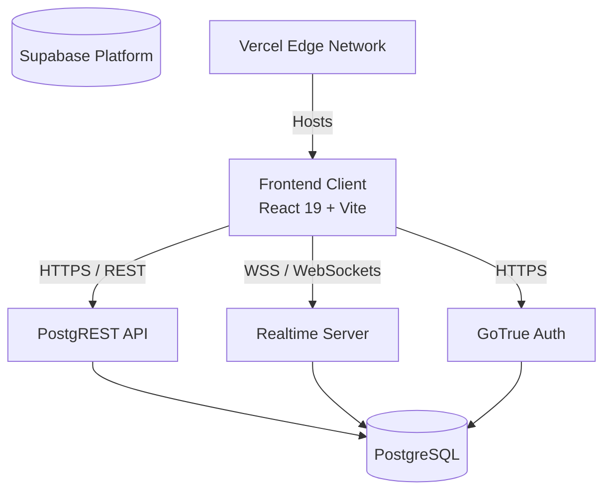
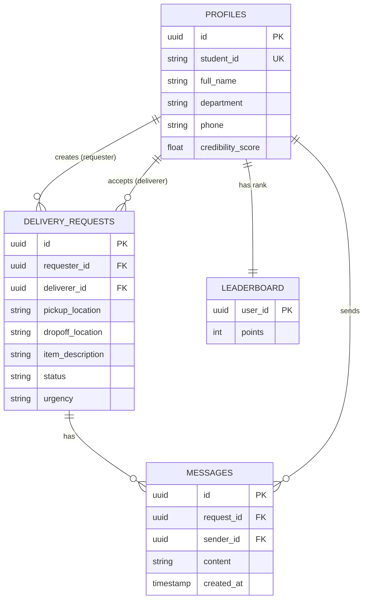

# BringIt - Software Design Document (SDD)

This document provides a complete end-to-end software design for the BringIt prototype, applying advanced engineering skills including Security Threat Modeling, API Design, TDD, Error Handling, and high-quality UI/UX principles (`emil-kowalski-design`, `design-taste-frontend`).

---

## 1. System Architecture

The system follows a classic **Backend-as-a-Service (BaaS)** architecture to minimize DevOps overhead and accelerate prototyping.

---

## 2. Database Design & Security (Supabase PostgreSQL)

### 2.1 Entity Relationship Diagram

### 2.2 Security Threat Model & RLS (Row Level Security)
Applying `security-threat-model` and `security-best-practices`:

1.  **Profiles Table:**
    *   `SELECT`: Public to authenticated users (needed for leaderboard and matching).
    *   `UPDATE`: Users can only update their own row (`auth.uid() = id`).
2.  **Delivery Requests Table:**
    *   `SELECT`: Anyone can view `status = 'Open'`. Only the specific `requester_id` or `deliverer_id` can view it once accepted to prevent data leakage of ongoing routes.
    *   `INSERT`: Only authenticated users, `requester_id` must match `auth.uid()`.
    *   `UPDATE`: 
        *   Requesters can update if status is `Open`.
        *   Deliverers can only update `status` from `Accepted` to `In Progress` to `Delivered`.
3.  **Messages Table:**
    *   `SELECT` & `INSERT`: Users can only read/write if their `auth.uid()` matches the `requester_id` or `deliverer_id` of the parent `delivery_requests` row.

---

## 3. Frontend Architecture (`design-taste-frontend` & `impeccable`)

### 3.1 Tech Stack
*   **Core:** React 19, Vite, React Router v7.
*   **Styling:** Tailwind CSS v4, Lucide React (Icons).
*   **UI Primitives:** Radix UI (accessible headless components).
*   **UX Enhancements (`emil-kowalski-design`):**
    *   **Vaul:** For native-feeling bottom-sheet drawers on mobile (used for viewing request details or filtering).
    *   **Sonner:** For non-intrusive, stackable toast notifications.
    *   **Framer Motion:** For micro-interactions (e.g., list reordering, spring physics on buttons).

### 3.2 State & Data Management (`error-handling-patterns`)
We will use **React Query (@tanstack/react-query)** to wrap the Supabase client.
*   **Why?** Supabase JS is great, but React Query provides automatic caching, background refetching, and distinct `isLoading`, `isError`, and `isSuccess` states.
*   **Error Handling:** We will standardize a `Result` wrapper for Supabase calls so UI components never crash from unhandled promises.

### 3.3 Component Structure (Anti-Slop Design)
*   **Layout:** A bottom navigation bar for mobile (Home, Post, Leaderboard, Profile).
*   **Cards:** Delivery requests are rendered as high-contrast cards. Instead of dumping all data, we emphasize *Pickup*, *Dropoff*, and *Urgency*.
*   **Empty States:** If no deliveries exist, show a beautifully illustrated empty state encouraging the user to post one.

---

## 4. API & Realtime Specification (`api-design-principles`)

Since we use Supabase, we interact directly via the Supabase Client (PostgREST). 

### 4.1 Realtime Channels
We will utilize Supabase Realtime (WebSockets) for two critical features:
1.  **Live Status Tracking:** 
    *   Channel: `delivery_status_{id}`
    *   Event: `UPDATE` on `delivery_requests` table where `id = {id}`.
    *   UX: When a deliverer marks "In Progress", the requester's UI instantly updates without refreshing.
2.  **Live Chat:**
    *   Channel: `chat_room_{request_id}`
    *   Event: `INSERT` on `messages` table where `request_id = {id}`.

### 4.2 Graceful Degradation
If the WebSocket connection drops (e.g., moving between campus WiFi and mobile data):
*   Catch the disconnect event.
*   Show a small Sonner toast: *"Offline: Reconnecting..."*
*   Fall back to React Query polling (every 15 seconds) until the socket reconnects.

---

## 5. Matching Algorithm Design

To keep the MVP robust without relying on complex Machine Learning, we use a **Deterministic Weighted Formula**.

**Score = (w1 × Route) + (w2 × Time) + (w3 × Urgency) + (w4 × Credibility)**

*   **Route Overlap (w1 = 0.4):** Calculated by checking if the pickup/dropoff zones match the deliverer's predefined path zones (e.g., "Hall A to Academic Building 1").
*   **Time Compatibility (w2 = 0.3):** Boolean or graded match based on the requested delivery window.
*   **Urgency (w3 = 0.2):** High = 1.0, Medium = 0.5, Low = 0.1.
*   **Credibility (w4 = 0.1):** Normalized user rating (e.g., 4.5/5.0 = 0.9).

*This logic will run as a Supabase Edge Function or a database function (RPC) to keep the client light.*

---

## 6. Testing Strategy (`test-driven-development`)

Applying strict TDD and `verification-before-completion`:

1.  **Unit Tests (Vitest):**
    *   Test the Matching Algorithm function purely (input routes -> output scores).
    *   Test React utility functions (e.g., time formatting).
2.  **Component Tests (React Testing Library):**
    *   Ensure the `DeliveryCard` renders correct urgency colors.
    *   Test Vaul drawer interactions.
3.  **Integration & Security Tests:**
    *   Write tests against a local Supabase instance to verify RLS policies (e.g., assert that User A querying User B's private messages returns an empty array or 403).
4.  **E2E (Playwright):**
    *   The "Golden Path": Login -> Create Request -> Deliverer Accepts -> Status to Delivered -> Leaderboard Updates.

---

## 7. Deployment & Operations

*   **Frontend Hosting:** Vercel Edge Network.
*   **Backend:** Supabase Managed Platform (Production Environment).
*   **CI/CD:** GitHub Actions configured to:
    1. Run Vitest on PRs.
    2. Check TypeScript types (`tsc --noEmit`).
    3. Block merges if tests fail (`verification-before-completion`).
*   **Environment Variables:** 
    *   `VITE_SUPABASE_URL`
    *   `VITE_SUPABASE_ANON_KEY`
    *(Never expose the Service Role key in the frontend).*
